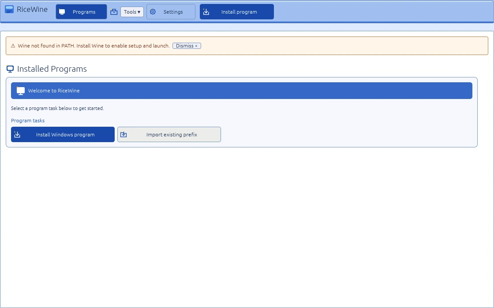
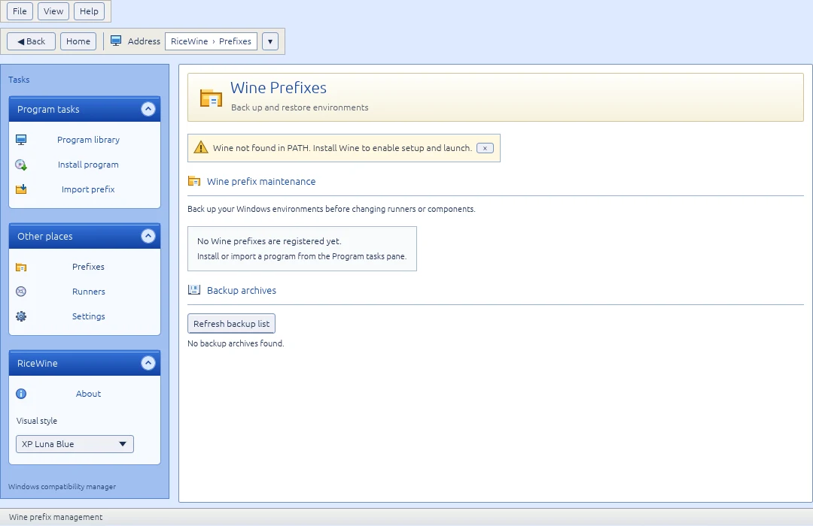
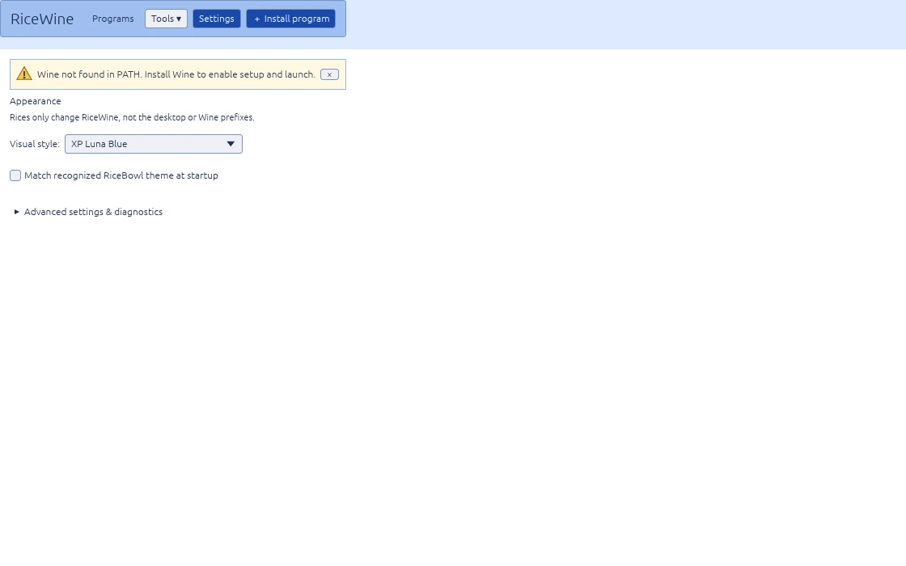
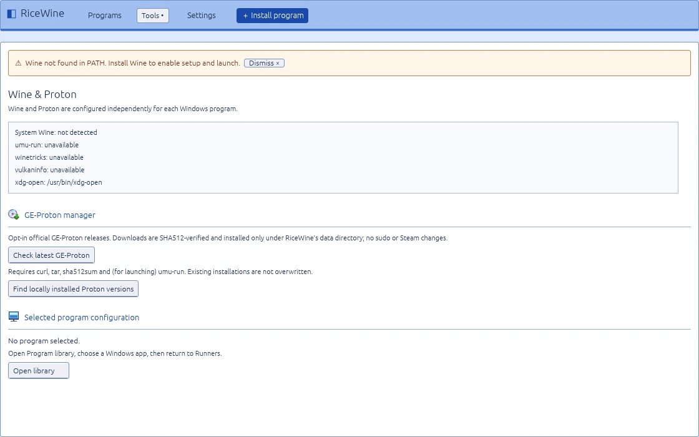
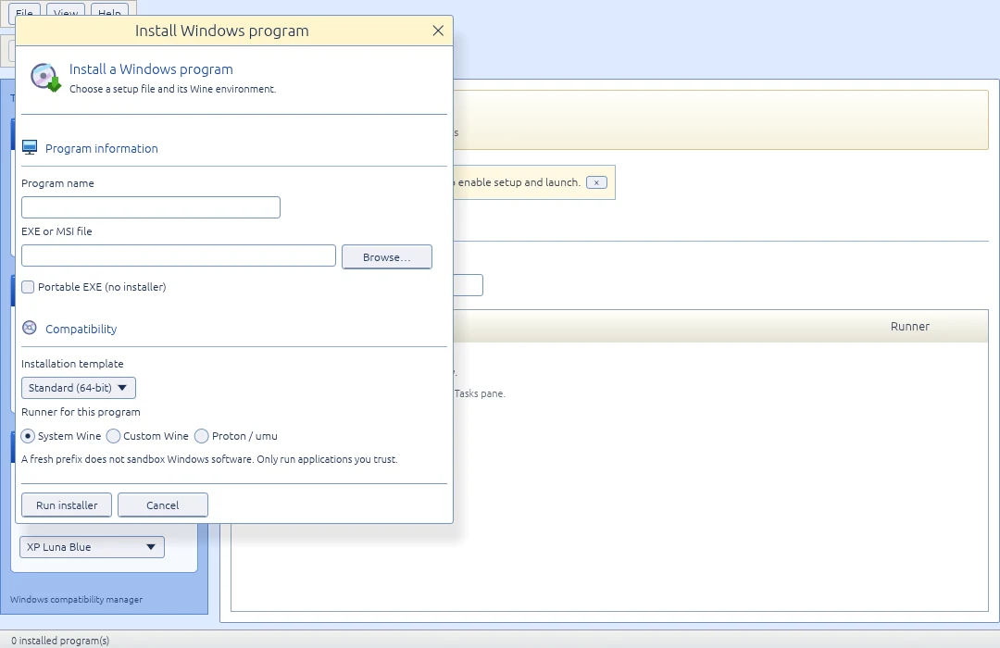
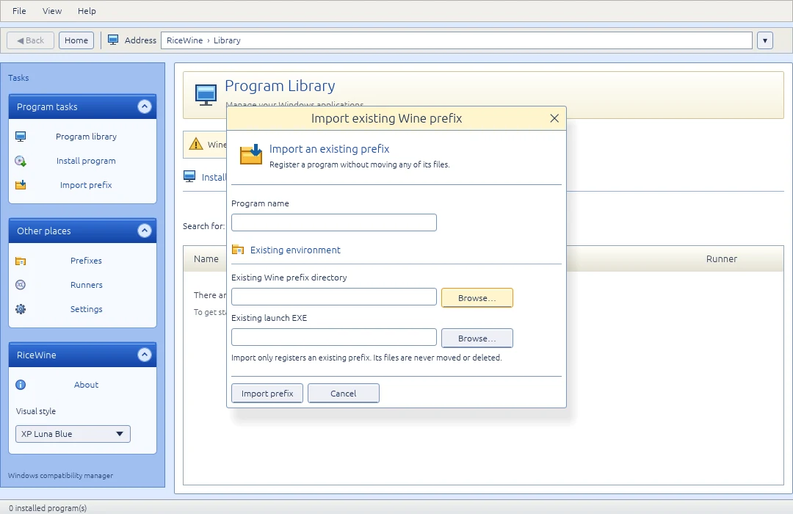

# RiceWine

**A lightweight Wine & Proton manager for Linux, built with Rust.**

Install, organize and launch Windows applications in separate Wine prefixes — with a native desktop UI and two maintained Rices. Works standalone or alongside RiceBowl; no background service required.

> **Version 2.0.0-beta.1** · Feature-complete software beta. Real Wine/Proton and X11/Wayland acceptance remains outstanding; this is **not** a stable release.

## Features

- **Application library:** install EXE/MSI files, register portable apps, search, rename, launch and stop programs. Cancel setup without deleting its partial prefix; automatically detect obvious launch EXEs and review ambiguous ones.
- **Runners:** system Wine, custom Wine and Proton via [`umu-run`](https://github.com/Open-Wine-Components/umu-launcher). Discover installed Proton builds or download the latest **SHA512-verified GE-Proton** into a managed user-local folder. Remove managed, unused builds with confirmation.
- **Compatibility:** isolated prefixes, five launch presets, custom arguments, allowlisted environment overrides and Winetricks components (including DXVK/VKD3D where available).
- **Recovery:** import existing prefixes, create full prefix backups and restore into a *new* prefix without overwriting the original.
- **Space & updates:** calculate per-prefix disk usage, preview removal of old Wine temporary files, optionally check the latest GitHub release of an app and run a trusted update installer inside its existing prefix.
- **Desktop integration:** application-menu shortcuts, optional *Open With RiceWine* and read-only RiceBowl theme detection.
- **Diagnostics:** live status, logs, library verification and a few useful CLI commands.

## Maintained Rices

**macOS** has its own Finder-inspired application shell with a grouped navigation sidebar, compact toolbar with real install/import actions, subtle list treatment and a status bar. It styles only RiceWine's interior; the compositor still renders the actual window decorations. This is a new implementation, pending real X11/Wayland visual acceptance.

**XP Luna Blue** now uses a dedicated XP-era application UI: functional Explorer menus and address navigation, shaded task panes, original application icons, beveled controls, compact classic forms, and consistent management pages. **The native titlebar and window borders are never replaced**; RiceBowl/the Linux compositor owns them.

These are six genuine screenshots from the Linux build (including real, isolated install/import dialogs):



| Wine Prefixes | Settings |
| :---: | :---: |
|  |  |



| Install program | Import existing Wine prefix |
| :---: | :---: |
|  |  |

Only **macOS** and **XP Luna Blue** are offered in Settings. The incomplete Windows 10 Light/Dark and XP Luna Olive/Silver experiments were retired. Existing preferences referencing those variants automatically fall back to Luna Blue; the program catalog, prefixes, backups and runner settings are untouched. Manual selection persists across restarts and does not change the Linux desktop or Wine configuration.

## Install

**Requirements:** Linux (X11 or Wayland), OpenGL, Rust/Cargo and a supported Wine runner. System Wine needs `wine` and `wineboot` in `PATH`; Proton needs `umu-run`. GE-Proton management additionally uses `curl`, `tar` and `sha512sum`.

```bash
git clone https://github.com/CopyPasteUser/Ricewine.git
cd Ricewine
sh scripts/install-user.sh
```

RiceWine is installed to `~/.local/bin/ricewine` with a user-local application-menu entry. No `sudo` is needed. To run without installing, use `cargo run --release` from the repository.

**First steps:** Select **Install program**, choose an EXE/MSI or portable EXE, then a runner. RiceWine attempts to identify the launch EXE automatically; verify it and use **Scan installed EXEs** or **Choose launch EXE** if needed. Use **Prefixes** for backups, disk usage and optional cleanup; **Runners** for compatibility presets, GE-Proton management and app updates.

To remove RiceWine **without deleting your applications, prefixes or backups**:

```bash
sh scripts/uninstall-user.sh
```

The installer keeps a backup of a previous RiceWine binary and restores it if menu registration fails. Neither script overwrites unrelated executables or follows executable symlinks.

## Data & safety

RiceWine stores its catalog, preferences, prefixes, logs and backups under `${XDG_DATA_HOME:-$HOME/.local/share}/ricewine/`.

- Removing a program from the library **does not delete its prefix**.
- Full prefix backups are manual; restore creates a separate program entry and prefix. Close Wine processes before backing up.
- Cancel/Stop target only RiceWine-launched processes; Windows programs that detach from the runner may require manual shutdown. Cancelled installations preserve their partial prefix for diagnosis.
- Cleanup is opt-in and requires a preview and explicit confirmation. It deletes only regular files older than seven days in temp folders of RiceWine-owned prefixes. Imported/external prefixes are never cleaned.
- `--snapshot-library` backs up **catalog/preferences only**, not installed applications.
- Managed GE-Proton downloads are checksum-verified against the publisher's release assets; existing installations are never overwritten. System Wine installation and updates remain your distro package manager's responsibility. Proton MSI installation and Winetricks on Proton are unsupported.
- Windows app update checks are **opt-in GitHub release checks** (`owner/repo`), not universal version detection. Publisher installers must be selected and approved manually; a completed installer does not guarantee a successful application update.
- **Wine prefixes are not security sandboxes.** Windows programs can access files allowed to your Linux user. Run only software you trust.

Useful diagnostics:

```bash
ricewine --list
ricewine --diagnose
ricewine --verify-library
ricewine --snapshot-library
```

## Release status

| Milestone | Status |
| --- | --- |
| 0.1–1.0 RC3 · core, backups and desktop integration | Implemented |
| **2.0 beta 1 · process control, discovery, managed GE-Proton, disk tools, presets and updates** | **Implemented; automated checks required** |
| 2.0 stable · real app tests, X11/Wayland review, recovery and performance | Awaiting manual acceptance |

See [the acceptance checklist](ACCEPTANCE.md) for real-desktop tests. No stable `v2.0.0` release has been published.

## Development

```bash
cargo fmt --all -- --check
cargo test --all-targets
cargo clippy --all-targets -- -D warnings
```

[Changelog](CHANGELOG.md) · [Contributing](CONTRIBUTING.md) · [Security](SECURITY.md)
