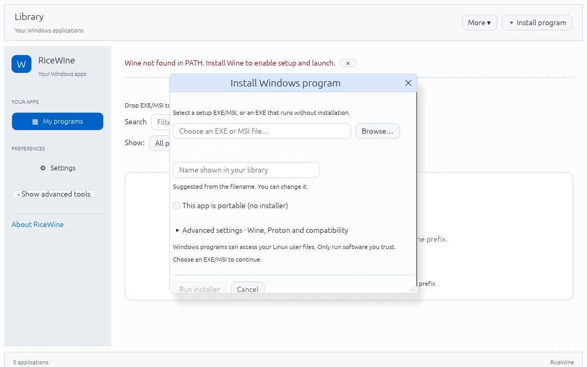
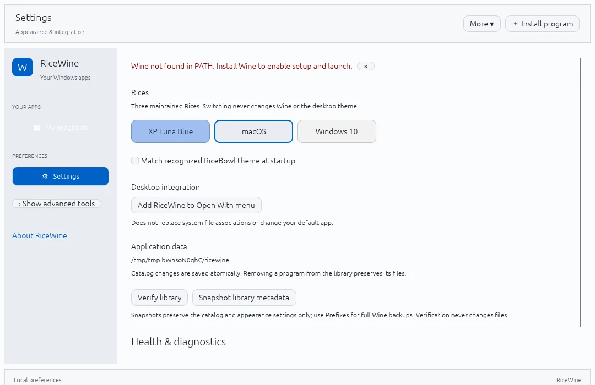
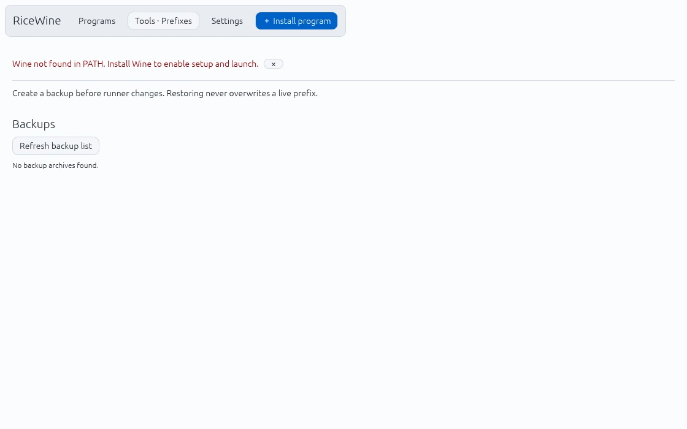
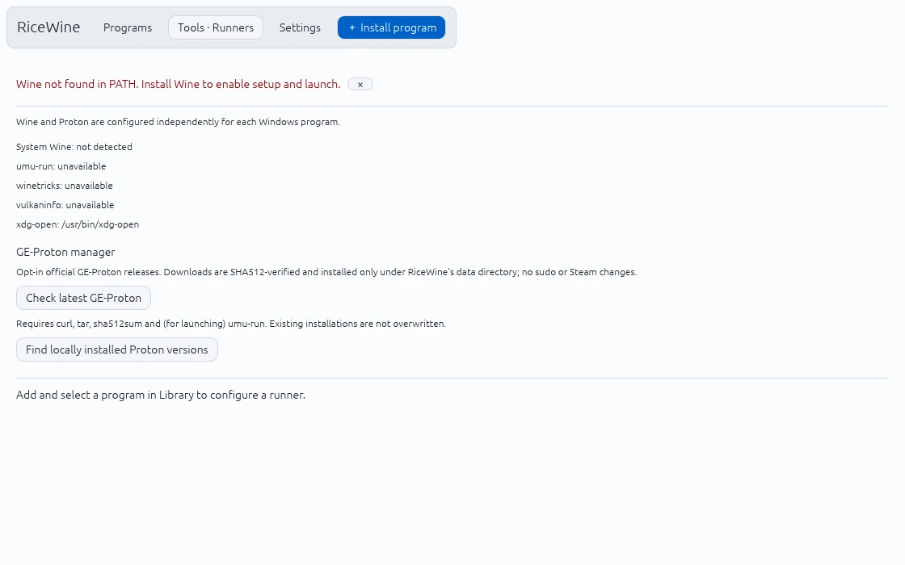
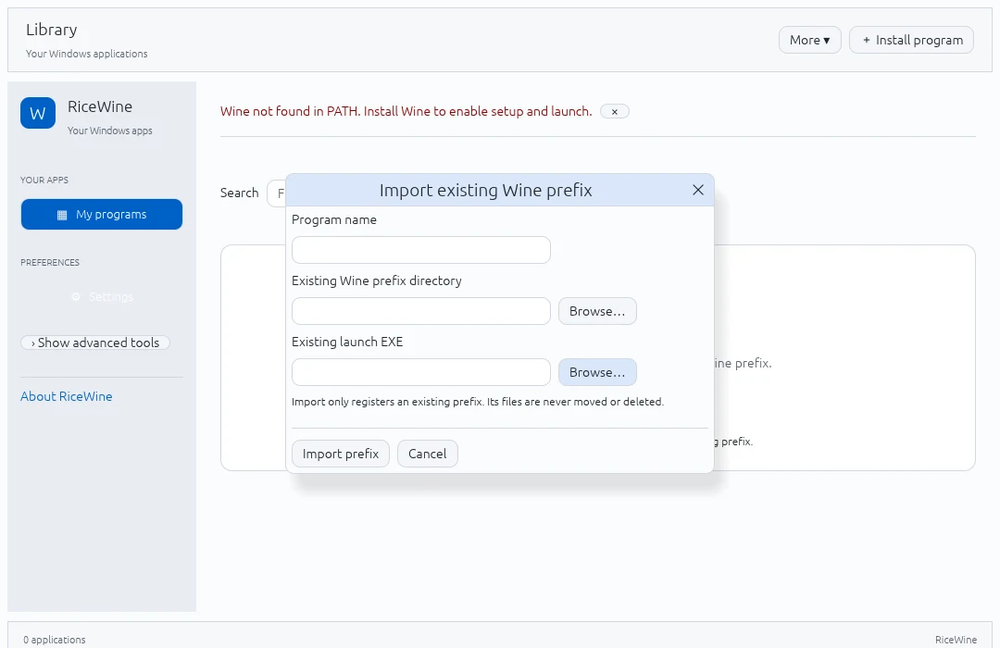
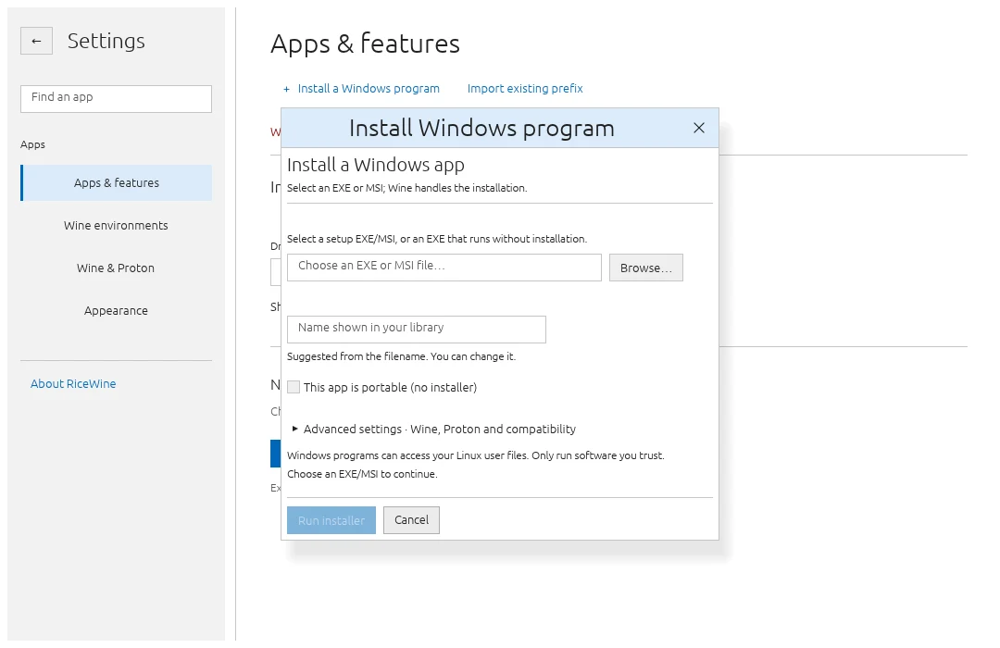
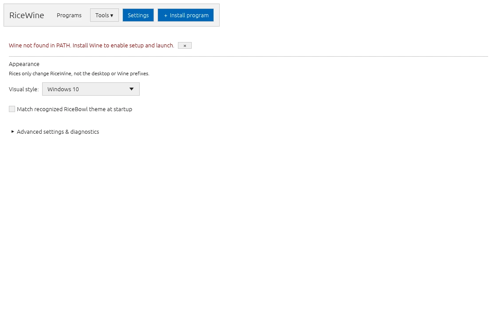
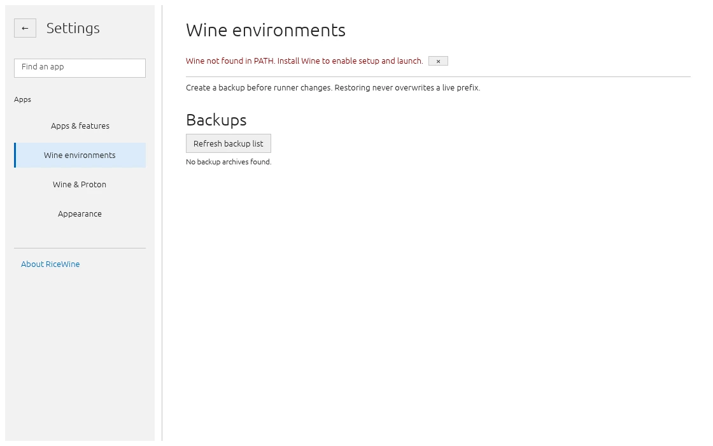
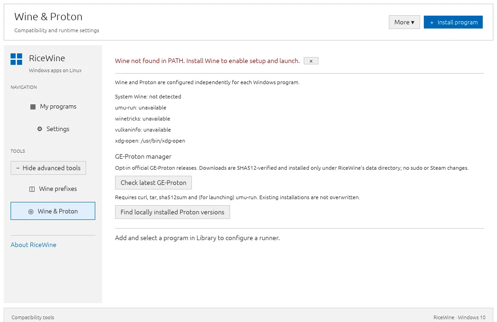
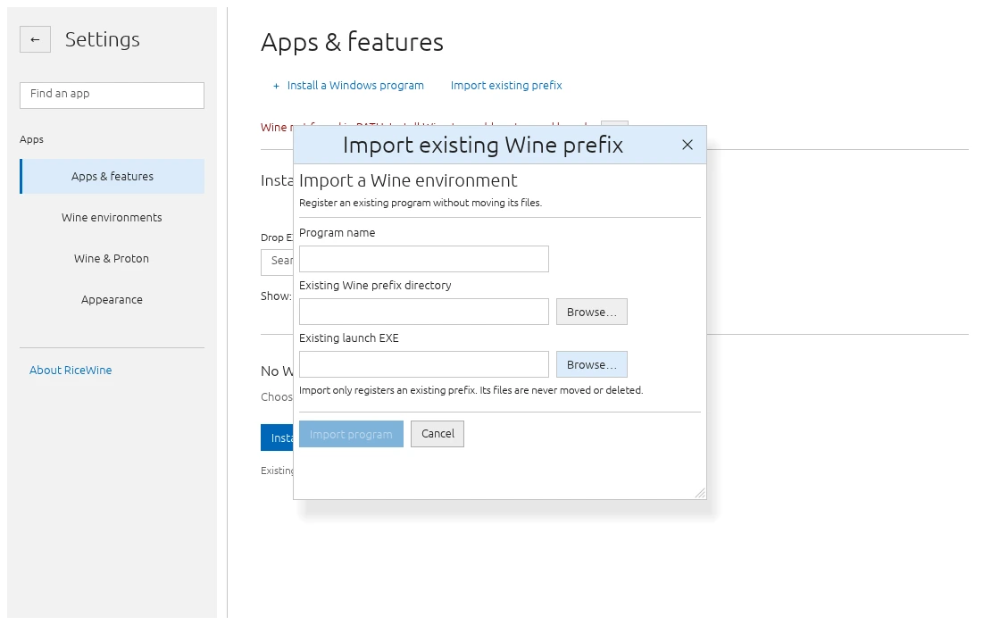

# RiceWine

**A lightweight Wine & Proton manager for Linux, built with Rust.**

Install, organize and launch Windows applications in separate Wine prefixes — with a native desktop UI and three maintained Rices. Works standalone or alongside RiceBowl; no background service required.

> **Version 3.0.0-alpha.2 (development)** · Personal library and read-only health diagnostics. Wine/Proton compatibility and real X11/Wayland acceptance remain outstanding; this is **not** a stable release.

**3.0 roadmap:** [ROADMAP-3.0.md](ROADMAP-3.0.md). Milestones 1–2 are implemented; guided recovery and real-device acceptance remain open.

## Features

- **3.0 personal workspace:** favorites, recently successfully launched apps, saved program filters and sorting. Metadata lives in a separate, atomic, user-local workspace.json and does not modify Wine prefixes or catalog schemas.
- **3.0 read-only diagnostics:** Settings → Health & diagnostics and **ricewine --doctor** report missing launch EXEs, incomplete prefixes and invalid runners, with suggested manual next steps. No repairs, installations or deletions are triggered.
- **3.0 guided recovery:** Select a program → **Diagnose & recover…** to check its prefix, view at most 12 KiB of recent Wine logs, open runner settings, find its launch EXE, or create/open backups. Before Winetricks changes RiceWine now asks for explicit confirmation and offers **Back up first** (never silently applies the component afterward).
- **Application library:** install EXE/MSI files, register portable apps, search, rename, launch and stop programs. Cancel setup without deleting its partial prefix; automatically detect obvious launch EXEs and review ambiguous ones.
- **Runners:** system Wine, custom Wine and Proton via [`umu-run`](https://github.com/Open-Wine-Components/umu-launcher). Discover installed Proton builds or download the latest **SHA512-verified GE-Proton** into a managed user-local folder. Remove managed, unused builds with confirmation.
- **Compatibility:** isolated prefixes, five launch presets, custom arguments, allowlisted environment overrides and Winetricks components (including DXVK/VKD3D where available).
- **Recovery:** import existing prefixes, create full prefix backups and restore into a *new* prefix without overwriting the original.
- **Space & updates:** calculate per-prefix disk usage, preview removal of old Wine temporary files, optionally check the latest GitHub release of an app and run a trusted update installer inside its existing prefix.
- **Desktop integration:** application-menu shortcuts, optional *Open With RiceWine* and read-only RiceBowl theme detection.
- **Diagnostics:** live status, logs, library verification and a few useful CLI commands.

## Maintained Rices

**macOS** has its own Finder-inspired application shell with a grouped navigation sidebar, compact toolbar with real install/import actions, subtle list treatment and a status bar. It styles only RiceWine's interior; the compositor still renders the actual window decorations. This is a new implementation, pending real X11/Wayland visual acceptance.

**XP Luna Blue** uses a dedicated XP-era application UI: functional Explorer menus and address navigation, shaded task panes, original application icons, beveled controls, compact classic forms, and consistent management pages. **The native titlebar and window borders are never replaced**; RiceBowl/the Linux compositor owns them.

**Windows 10** now follows the classic Windows 10 **Settings → Apps & features** layout (1809–1909 era): a light-gray Settings sidebar with an active blue selection rail, full-width app list, two-level app metadata, and in-page management controls. Appearance selection uses ordinary radio controls, while installer/import actions use small, flat Windows-style buttons. This is an independent app shell, **not** a recolored macOS UI. The icons are locally drawn, and the Linux compositor keeps the native window titlebar.

### macOS Rice · Screenshots

The gallery below is generated from **the actual Linux application** using an isolated Xvfb session. The screenshot workflow publishes the six macOS views to this repository after each relevant change on `main`. No mockup is presented as a running app.


| Easy installation | Settings |
| :---: | :---: |
|  |  |

<details>
<summary>More macOS views: prefixes, runners and import</summary>

| Wine prefixes | Wine and Proton runners | Import existing prefix |
| :---: | :---: | :---: |
|  |  |  |

</details>

### Windows 10 Rice · Screenshots

These captures are generated from the actual Linux application on Xvfb, with the same six real interface states as macOS and Luna:


| Installer | Settings |
| :---: | :---: |
|  |  |

<details>
<summary>More Windows 10 Rice views</summary>

| Prefixes | Runners | Import |
| :---: | :---: | :---: |
|  |  |  |

</details>

### XP Luna Blue · Screenshots

These six screenshots also come from a real Xvfb Linux application session:


| Wine Prefixes | Settings |
| :---: | :---: |
|  |  |


| Install program | Import existing Wine prefix |
| :---: | :---: |
|  |  |

The maintained choices in Settings are **macOS**, **XP Luna Blue** and **Windows 10**. The old Windows 10 Light/Dark preference names are read as the new unified Windows 10 Rice; XP Luna Olive/Silver preference names still migrate to Luna Blue. No existing program, prefix, backup or runner is deleted. Manual selection persists across restarts and never changes your Linux desktop or Wine configuration.

## Install

**Requirements:** Linux (X11 or Wayland), OpenGL, Rust/Cargo and a supported Wine runner. System Wine needs `wine` and `wineboot` in `PATH`; Proton needs `umu-run`. GE-Proton management additionally uses `curl`, `tar` and `sha512sum`.

```bash
git clone https://github.com/CopyPasteUser/Ricewine.git
cd Ricewine
sh scripts/install-user.sh
```

RiceWine is installed to `~/.local/bin/ricewine` with a user-local application-menu entry. No `sudo` is needed. To run without installing, use `cargo run --release` from the repository.

**First steps:** Choose **Install program** or drop a Windows EXE/MSI anywhere into the application. Both actions open the *same review dialog* — dropping never executes a file. The file comes first; RiceWine suggests a readable name, which you can edit before continuing. Standard + system Wine is the default, with Proton and other compatibility options under **Advanced settings**. Invalid details produce an inline error **without closing the dialog or discarding your input**.

After a successful install RiceWine automatically shows the new program, even if the library was previously filtered. If the launch EXE was detected, press **Play**. Otherwise select **Find EXE automatically** (the bounded scan runs off the UI thread), choose one of the offered candidates, or use **Choose EXE manually**. Importing an existing prefix similarly opens the imported program and keeps files in their original location. The other maintenance features remain under **More options**, **Prefixes** and **Runners**. Use **Refresh profiles** when you edit runner TOML files outside RiceWine.

To remove RiceWine **without deleting your applications, prefixes or backups**:

```bash
sh scripts/uninstall-user.sh
```

The installer keeps a backup of a previous RiceWine binary and restores it if menu registration fails. Neither script overwrites unrelated executables or follows executable symlinks.

## Data & safety

RiceWine stores its catalog, preferences, prefixes, logs and backups under `${XDG_DATA_HOME:-$HOME/.local/share}/ricewine/`.

- Removing a program from the library **does not delete its prefix**.
- Full prefix backups are manual; restore creates a separate program entry and prefix. Close Wine processes before backing up.
- Cancel/Stop target only RiceWine-launched processes; Windows programs that detach from the runner may require manual shutdown. Cancelled installations preserve their partial prefix for diagnosis.
- Cleanup is opt-in and requires a preview and explicit confirmation. It deletes only regular files older than seven days in temp folders of RiceWine-owned prefixes. Imported/external prefixes are never cleaned.
- `--snapshot-library` backs up **catalog/preferences only**, not installed applications.
- Managed GE-Proton downloads are checksum-verified against the publisher's release assets; existing installations are never overwritten. System Wine installation and updates remain your distro package manager's responsibility. Proton MSI installation and Winetricks on Proton are unsupported.
- Windows app update checks are **opt-in GitHub release checks** (`owner/repo`), not universal version detection. Publisher installers must be selected and approved manually; a completed installer does not guarantee a successful application update.
- **Wine prefixes are not security sandboxes.** Windows programs can access files allowed to your Linux user. Run only software you trust.

Useful diagnostics:

```bash
ricewine --list
ricewine --diagnose
ricewine --verify-library
ricewine --snapshot-library
```

## Release status

| Milestone | Status |
| --- | --- |
| 0.1–1.0 RC3 · core, backups and desktop integration | Implemented |
| **2.0 beta 1 · process control, discovery, managed GE-Proton, disk tools, presets and updates** | **Implemented; automated checks required** |
| 2.0 stable · real app tests, X11/Wayland review, recovery and performance | Awaiting manual acceptance |

See [the acceptance checklist](ACCEPTANCE.md) for real-desktop tests. No stable `v2.0.0` release has been published.

## Development

```bash
cargo fmt --all -- --check
cargo test --all-targets
cargo clippy --all-targets -- -D warnings
```

[Changelog](CHANGELOG.md) · [Contributing](CONTRIBUTING.md) · [Security](SECURITY.md)
