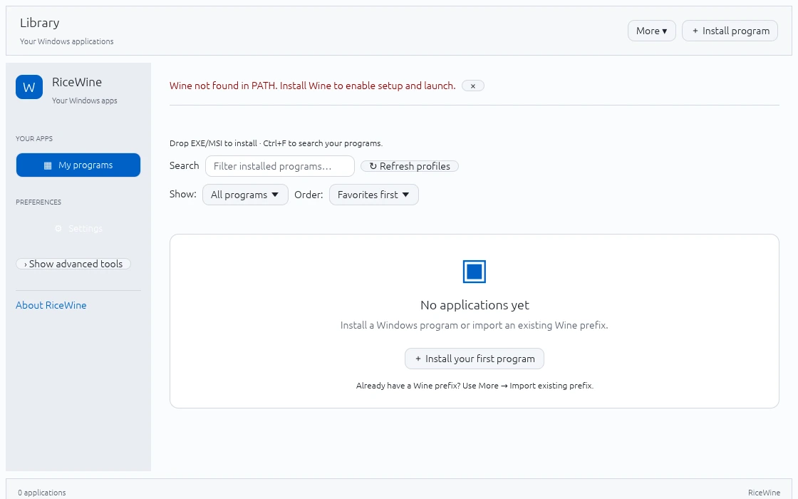
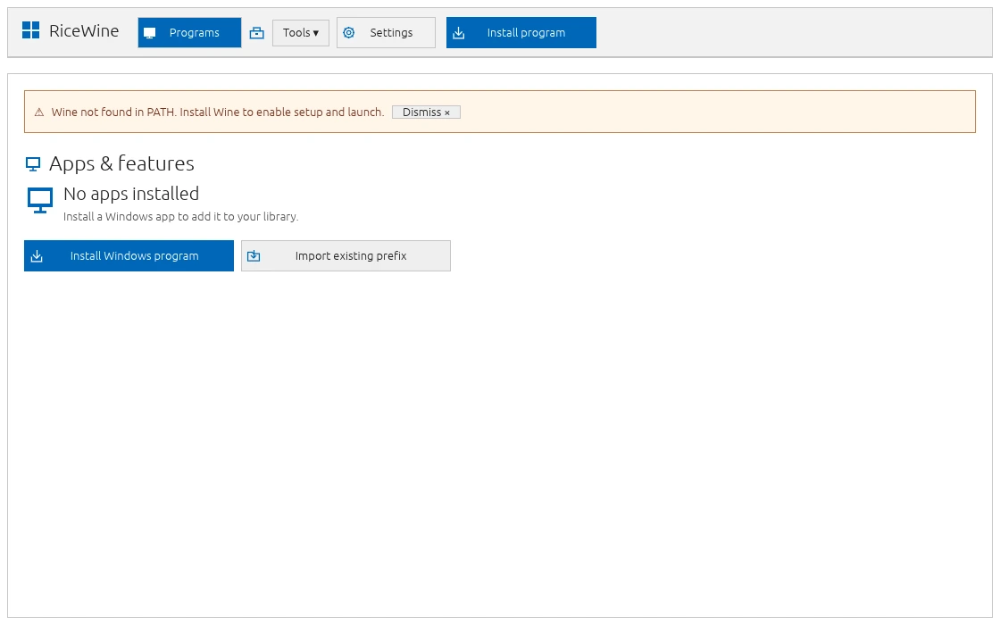
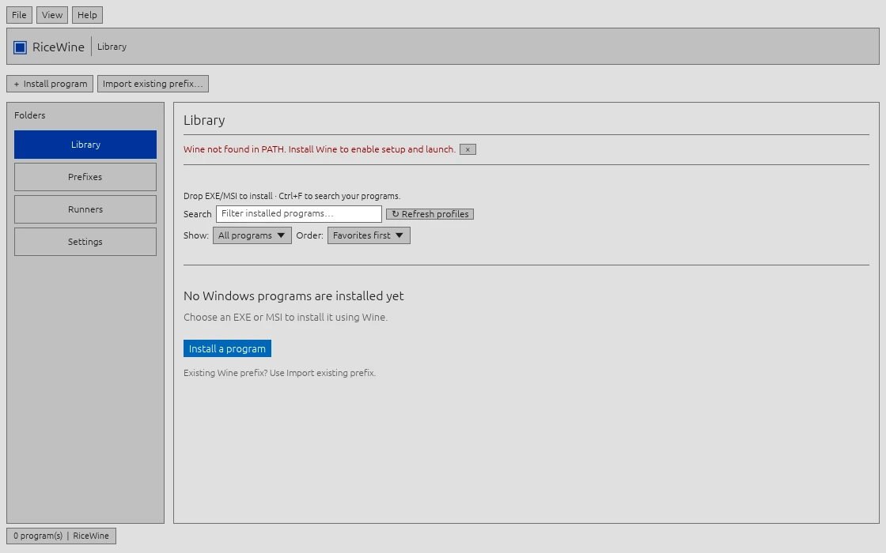
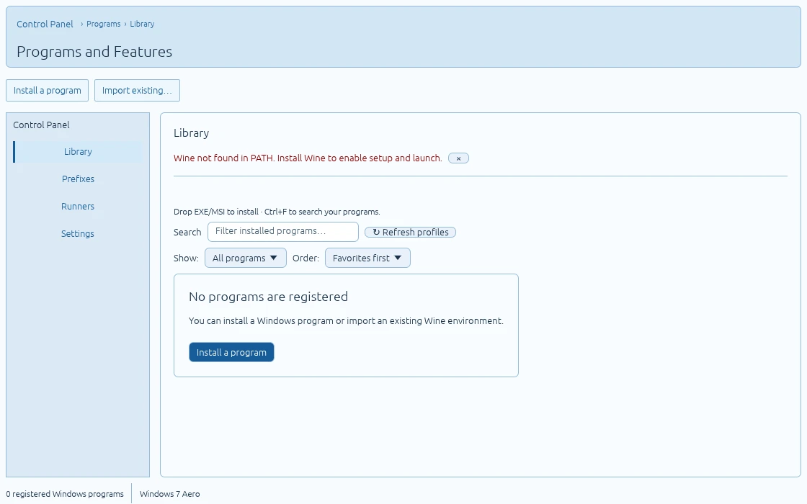
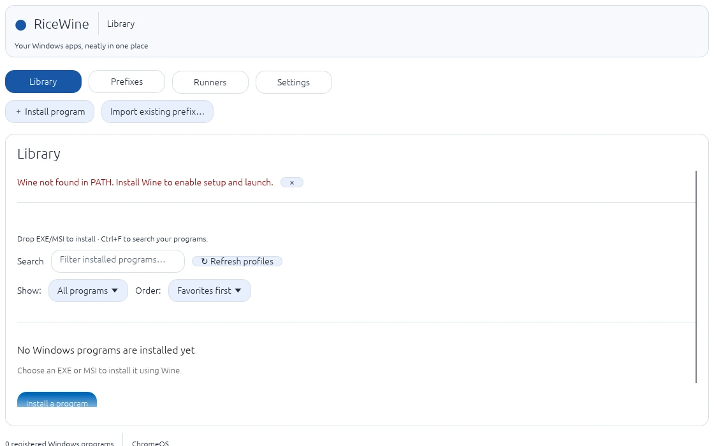
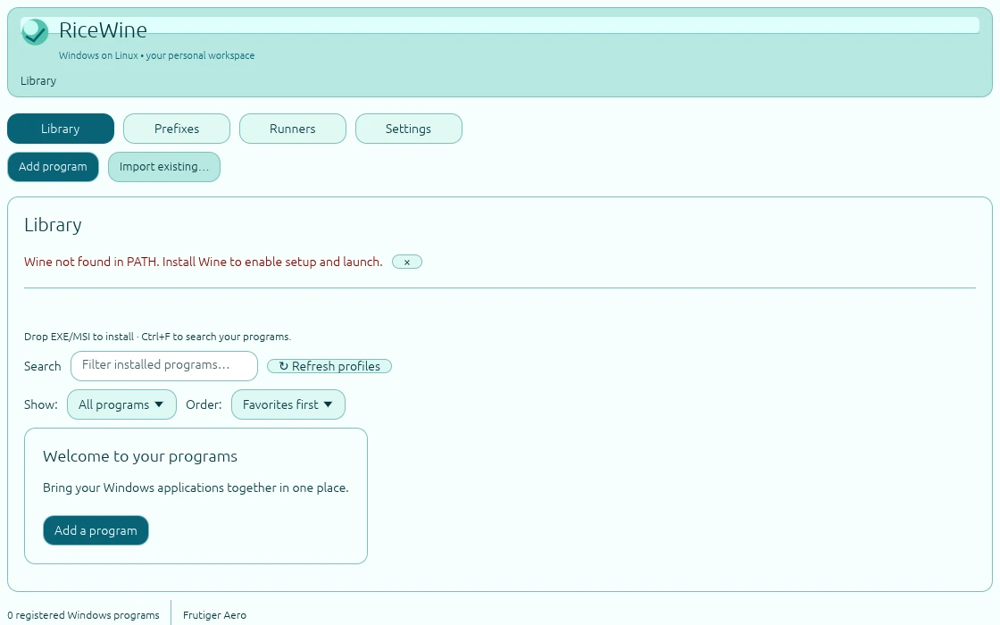

# RiceWine


**A lightweight Wine & Proton manager for Linux.** Install, organize and launch Windows applications in separate Wine prefixes through a native Rust desktop app. Works standalone or with RiceBowl — no daemon, account or telemetry.

> **Current development version: 3.0.0-alpha.3.** RiceWine is not a stable release yet. Real Wine/Proton and X11/Wayland acceptance tests are still required. See the [3.0 roadmap](ROADMAP-3.0.md).

## Preview

**XP Luna Blue**


| macOS | Windows 10 |
| :---: | :---: |
|  |  |

| Windows 98 | Windows 7 Aero |
| :---: | :---: |
|  |  |

| ChromeOS | Frutiger Aero |
| :---: | :---: |
|  |  |

[View all 42 screenshots →](docs/SCREENSHOTS.md)

The screenshots show the **real Linux application** rendered in an isolated Xvfb session, not design mockups. The screenshot workflow builds the current source and captures Library, Install, Import, Prefixes, Runners and Settings for all seven Rices. Linux controls the real window decoration.

## Everyday interface

RiceWine opens with a consistent, reduced layout in **all seven Rices**:

- **Programs:** search your library, select a program and launch it. Filters, favorites and per-program maintenance are available under *View* and *More options*.
- **Install program:** the main action opens a reviewable EXE/MSI setup dialog. No file runs just by dropping it.
- **Tools:** Wine prefixes/backups, Wine/Proton runners, importing existing prefixes and refreshing runner profiles.
- **Settings:** choose your Rice and optionally follow the desktop's recognized theme. Recovery and diagnostic controls remain under *Advanced settings & diagnostics*.

The seven appearances remain visual themes, not seven different navigation systems. For troubleshooting older appearance-specific layouts, start with `RICEWINE_CLASSIC_UI=1 ricewine`. This compatibility escape hatch does not affect Wine configuration or your application data.

The installer registers the bundled **RiceWine goblet icon** in the current user's XDG icon theme; the app-menu launcher, Open With entry and generated RiceWine shortcuts use the matching `ricewine` icon name.

## Features

- **Simple app library:** install EXE/MSI files, register portable apps, search, favorite, sort, launch and stop tracked programs.
- **Wine & Proton:** use system/custom Wine or Proton via [umu-run](https://github.com/Open-Wine-Components/umu-launcher); manage checksum-verified GE-Proton builds.
- **Separate prefixes:** per-app compatibility settings, launch arguments, environment overrides and optional Winetricks components.
- **Recovery:** import existing prefixes, back up a prefix and restore it into a **new** prefix without overwriting the original.
- **Useful diagnostics:** check missing executables, prefixes and runners; inspect recent logs and follow explicit recovery steps.
- **Maintenance:** inspect disk usage, preview safe temporary-file cleanup and optionally review GitHub-hosted application updates.
- **Desktop integration:** create Linux application-menu shortcuts and optionally enable *Open with RiceWine*.

### Seven RiceBowl-inspired Rices

| Rice | Style |
| --- | --- |
| **XP Luna Blue** | Classic Explorer menus, task panes and XP-inspired icons |
| **macOS** | Finder-inspired navigation and compact application lists |
| **Windows 10** | Settings / Apps & features layout |
| **Windows 98** | Gray classic shell, square beveled controls and desktop-style menus |
| **Windows 7 Aero** | Pale blue shell with Control Panel navigation |
| **ChromeOS** | Compact top-level navigation with rounded controls |
| **Frutiger Aero** | Aqua-inspired navigation and bright translucent-looking surfaces |

Choose a Rice in **Settings**, or enable **Follow desktop** to recognize matching RiceBowl GTK theme families. All seven share the same working Wine management workflows; changing the Rice never alters the Linux desktop, installed applications or Wine prefixes. The Linux window decorations remain native. Former XP Olive/Silver and Windows 10 Light/Dark preferences migrate to their maintained equivalents.

## Install

**Requirements:** Linux (X11 or Wayland), OpenGL, Rust/Cargo and a Wine runner. System Wine requires `wine` and `wineboot`; Proton requires `umu-run`. GE-Proton downloads additionally require `curl`, `tar` and `sha512sum`.

```bash
git clone https://github.com/CopyPasteUser/Ricewine.git
cd Ricewine
sh scripts/install-user.sh
```

This builds and installs RiceWine in `~/.local/bin/ricewine` and adds a user-local desktop entry — **no sudo**. For a development run, use `cargo run --release`.

To uninstall the program **without deleting your Wine prefixes, applications or backups**:

```bash
sh scripts/uninstall-user.sh
```

### First run

1. Select **Install program**, or drop an EXE/MSI onto the window. The file is reviewed first; dropping it **never executes it**.
2. Check the suggested program name and settings. **System Wine / Standard** is the default; advanced runner options are optional.
3. Install, then select the detected launch EXE. If detection is ambiguous, use **Find EXE automatically** or **Choose EXE manually**.
4. Find maintenance tools under **More options**, **Prefixes** and **Runners**.

Import existing prefixes without moving their files. Failed or cancelled installs keep their partial prefix for diagnosis.

## Safety & data

RiceWine stores its user-local catalog, settings, logs, managed prefixes and backups under `~/.local/share/ricewine/` (or the configured XDG data directory).

- Removing an app entry **does not delete its prefix**.
- Restoring a backup creates a separate prefix and app entry. Close Wine processes before backing up.
- Cleanup is opt-in, previewed and restricted to eligible old temporary files in RiceWine-managed prefixes.
- Winetricks changes and update installers require explicit approval; optional backup-first actions are available.
- Wine prefixes **are not sandboxes**. Windows applications can access files permitted to your Linux user.

Troubleshooting:

```bash
ricewine --doctor
ricewine --diagnose
ricewine --verify-library
```

For metadata-only backup, use `ricewine --snapshot-library` — it does **not** back up application files or Wine prefixes.

## Project status & development

| 3.0 milestone | Status |
| --- | --- |
| Personal library, favorites and search | Implemented in alpha |
| Read-only health diagnostics | Implemented in alpha |
| Guided recovery and backup-first maintenance | Partially implemented |
| Real Wine/Proton, X11/Wayland acceptance and performance | **Outstanding** |

**Do not treat the alpha as a stable 3.0 release.** See the [roadmap](ROADMAP-3.0.md) and [acceptance checklist](ACCEPTANCE.md) for the remaining work.

```bash
cargo fmt --all -- --check
cargo test --all-targets
cargo clippy --all-targets -- -D warnings
```

[Changelog](CHANGELOG.md) · [Design](DESIGN.md) · [Contributing](CONTRIBUTING.md) · [Security](SECURITY.md)
