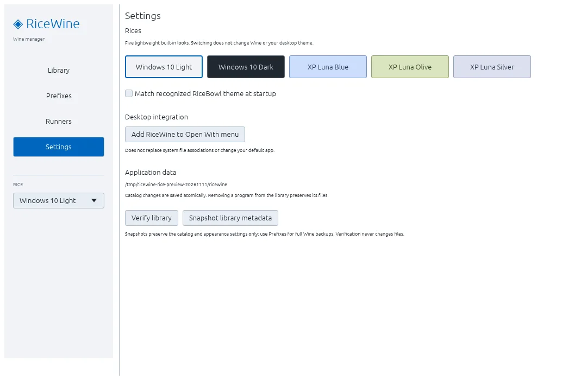
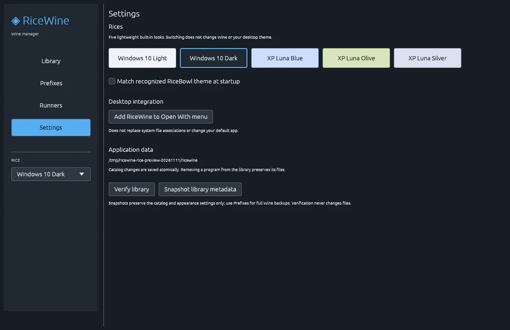
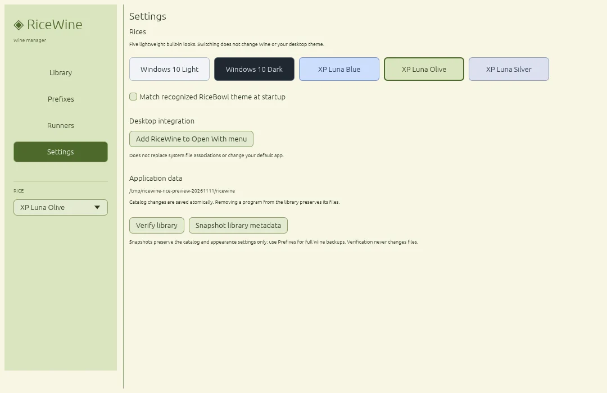
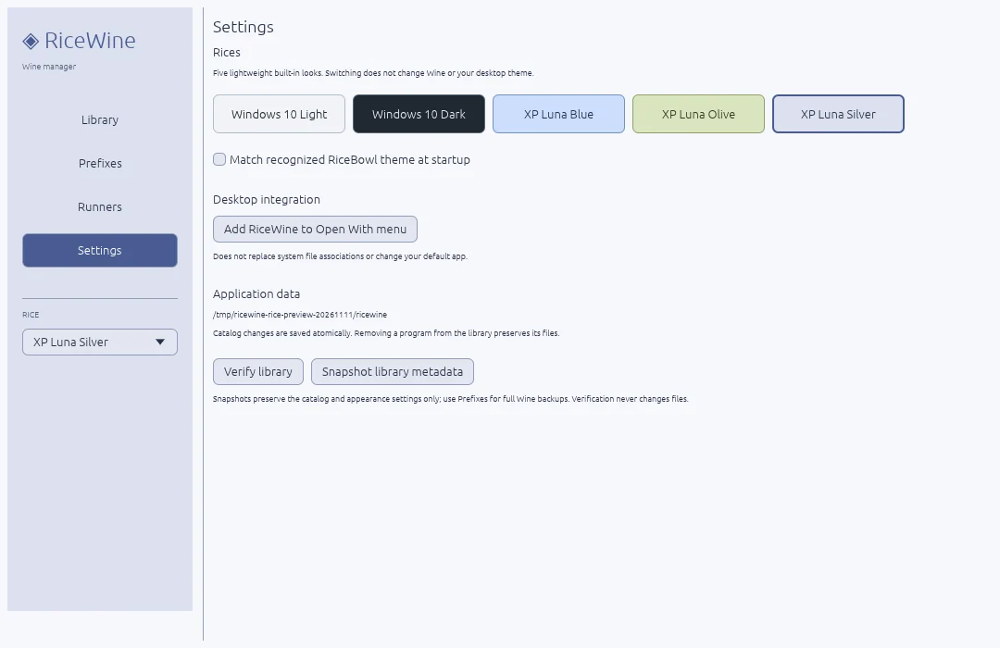

# RiceWine

**A lightweight Wine & Proton manager for Linux, built with Rust.**

Install, organize and launch Windows applications in separate Wine prefixes — with a native desktop UI and five built-in Rices. Works standalone or alongside RiceBowl; no background service required.

> **Version 1.0.0-rc.3** · Release candidate. Real Wine/Proton and X11/Wayland acceptance is still required before 1.0 stable.

## Features

- **Application library:** install EXE/MSI files, register portable apps, search, rename and launch programs.
- **Runners:** system Wine, custom Wine and Proton via [`umu-run`](https://github.com/Open-Wine-Components/umu-launcher); discover local Proton installs.
- **Per-app configuration:** isolated prefixes, launch arguments, selected environment overrides and Winetricks components (including DXVK/VKD3D where available).
- **Recovery:** import existing prefixes, create full prefix backups and restore into a *new* prefix without overwriting the original.
- **Desktop integration:** application-menu shortcuts, optional *Open With RiceWine* and read-only RiceBowl theme detection.
- **Diagnostics:** live status, logs, library verification and a few useful CLI commands.

## Built-in Rices

**XP Luna Blue** now has its own XP-inspired window chrome, Explorer task panes and program-library layout. The old palette-only screenshot is being replaced after a fresh desktop capture.

The other four Rices are unchanged:

| Windows 10 Light | Windows 10 Dark |
| :---: | :---: |
|  |  |
| XP Luna Olive | XP Luna Silver |
|  |  |

Switch instantly using the sidebar or the previews in **Settings**. Your choice is saved across restarts. Manually selecting a Rice disables optional RiceBowl theme following; switching does not change your desktop or Wine configuration.

## Install

**Requirements:** Linux (X11 or Wayland), working OpenGL graphics, Rust/Cargo and a supported Wine runner. System Wine needs `wine` and `wineboot` in `PATH`; Proton needs `umu-run` and a locally installed Proton build.

```bash
git clone https://github.com/CopyPasteUser/Ricewine.git
cd Ricewine
sh scripts/install-user.sh
```

RiceWine is installed to `~/.local/bin/ricewine` with a user-local application-menu entry. No `sudo` is needed. To run without installing, use `cargo run --release` from the repository.

**First steps:** Select **Install program**, choose an EXE/MSI or portable EXE, then select its runner. After a setup program finishes, use **Choose launch EXE** to register the installed application. You can adjust its runner and compatibility components later.

To remove RiceWine **without deleting your applications, prefixes or backups**:

```bash
sh scripts/uninstall-user.sh
```

The installer keeps a backup of a previous RiceWine binary and restores it if menu registration fails. Neither script overwrites unrelated executables or follows executable symlinks.

## Data & safety

RiceWine stores its catalog, preferences, prefixes, logs and backups under `${XDG_DATA_HOME:-$HOME/.local/share}/ricewine/`.

- Removing a program from the library **does not delete its prefix**.
- Full prefix backups are manual; restore creates a separate program entry and prefix. Close Wine processes before backing up.
- `--snapshot-library` backs up **catalog/preferences only**, not installed applications.
- Proton MSI installation and Winetricks on Proton are not supported yet. RiceWine does not download runners or game-store content.
- **Wine prefixes are not security sandboxes.** Windows programs can access files allowed to your Linux user. Run only software you trust.

Useful diagnostics:

```bash
ricewine --list
ricewine --diagnose
ricewine --verify-library
ricewine --snapshot-library
```

## Release status

| Milestone | Status |
| --- | --- |
| 0.1–0.9 · core, runners, backups, desktop integration | Implemented |
| **1.0 RC3 · five Rices, safety, diagnostics, installer and tests** | **Available** |
| 1.0 stable · real app tests, X11/Wayland review, recovery and performance | Awaiting acceptance |

See [the acceptance checklist](ACCEPTANCE.md) for the remaining real-desktop tests. No stable `v1.0.0` release has been published.

## Development

```bash
cargo fmt --all -- --check
cargo test --all-targets
cargo clippy --all-targets -- -D warnings
```

[Changelog](CHANGELOG.md) · [Contributing](CONTRIBUTING.md) · [Security](SECURITY.md)
